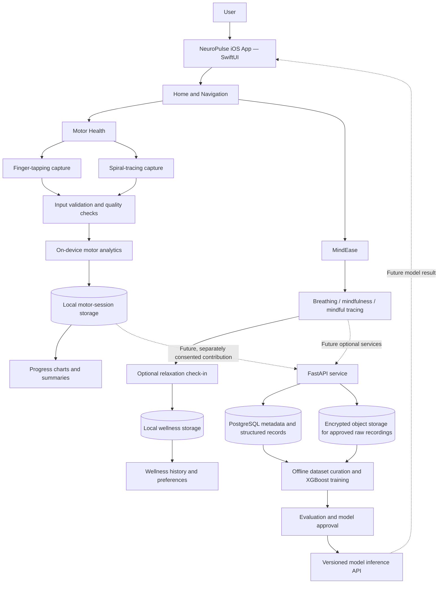
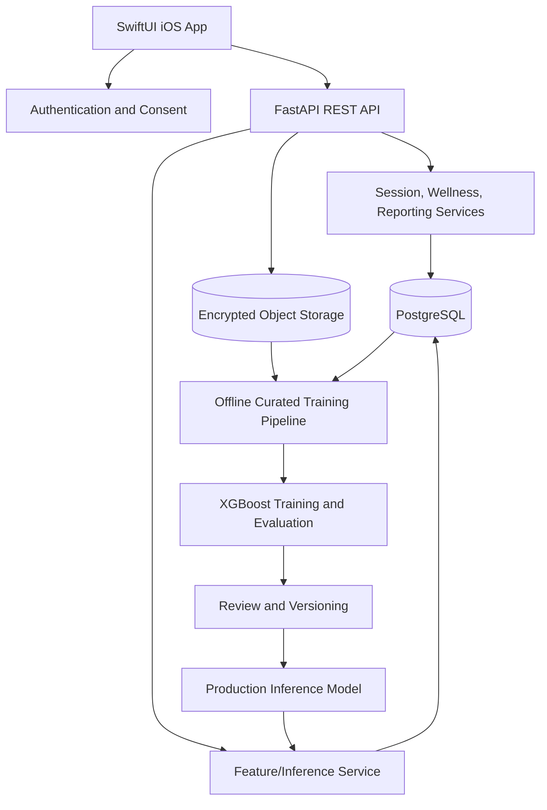

# NeuroPulse AI — Technical Architecture

**Status:** Target architecture; initial implementation is a native iOS MVP.  
**Repository:** `https://github.com/hiten-builds/NeuroPulseAI.git`  
**Rule:** Clearly distinguish implemented components from future design proposals.

## 1. Architecture overview

NeuroPulse AI has two independent feature domains in one iOS application:

- **Motor Health:** captures touch interactions, validates test quality, derives movement measurements, and presents personal history.
- **MindEase:** presents guided wellness activities and stores optional self-reported session feedback.

For the hackathon MVP, processing and storage should remain on-device. A server, database, XGBoost inference, research-data ingestion, EEG integration, and clinician dashboard are later extensions.



The dotted connections are future-state architecture and are not requirements for the current MVP.

## 2. Architecture principles

1. Build a modular native client first; avoid microservices and unnecessary dependencies.
2. Keep Motor Health, MindEase, and future EEG data domains separate.
3. Keep data capture separate from feature calculation so algorithms can be tested independently.
4. Keep raw measurements distinguishable from derived metrics, trends, and ML predictions.
5. No network connection is required for the first MVP.
6. Consent, authentication, and authorization are explicit requirements before server-side health-data processing.
7. ML training is an offline, reviewed pipeline; uploads do not automatically trigger deployment.
8. Make the intended data protocol and algorithm version visible in stored assessment results.
9. Use feature-specific folders and shared components only where reuse is real.
10. Never imply clinical validation without evidence.

## 3. Target folder structure

The outer folder is the Git repository root. The `.xcodeproj` must remain at that root. The inner `NeuroPulseAI/` directory contains the iOS application source and resources.

```text
NeuroPulseAI/                         # Git repository root
├── .gitignore
├── README.md
├── requirements.md
├── architecture.md
├── rules.md
├── phases.md
├── tasks.md
├── memory.md
├── NeuroPulseAI.xcodeproj/
└── NeuroPulseAI/                     # App source root
    ├── App/
    │   └── NeuroPulseAIApp.swift
    ├── Core/
    │   ├── DesignSystem/
    │   ├── Components/
    │   └── Utilities/
    ├── Features/
    │   ├── Home/
    │   │   └── HomeView.swift
    │   ├── MotorHealth/
    │   │   ├── Views/
    │   │   ├── Models/
    │   │   ├── Services/
    │   │   └── Components/
    │   ├── MindEase/
    │   │   ├── Views/
    │   │   ├── Models/
    │   │   └── Components/
    │   └── Progress/
    ├── Data/
    │   ├── Models/
    │   └── Storage/
    └── Resources/
        ├── Assets.xcassets/
        └── Audio/
```

### Folder rules

- Do not create empty placeholder files just to fill the structure; create folders when adding a feature.
- Keep `NeuroPulseAI.xcodeproj` at the root. Never place source code inside the `.xcodeproj` package.
- `NeuroPulseAIApp.swift` owns app entry and high-level setup.
- `Features/Home` owns the home screen and top-level navigation.
- `Features/MotorHealth` owns tapping, tracing, test protocols, and feature calculations directly tied to assessments.
- `Features/MindEase` owns breathing, mindfulness, and wellness check-ins.
- `Features/Progress` owns cross-session visualization, not measurement logic.
- `Data/Models` owns shared persistence models; feature-specific transient view models may live within features.
- `Core` contains genuinely reusable components, design tokens, and utilities.
- Keep assets where the Xcode target can resolve them; move `Assets.xcassets` only when project references are checked and the build remains successful.
- Inspect whether Xcode uses synchronized folders or explicit file references before adding/moving files. Verify every new Swift file is included in the app target.

## 4. Technology stack

### MVP (required)

| Layer | Technology | Purpose |
|---|---|---|
| iOS app | Swift + SwiftUI | Native interface, navigation, view state, touch gestures |
| Touch rendering | SwiftUI gestures and `Canvas` as appropriate | Tap capture and spiral path drawing |
| Charts | Swift Charts | Session history and movement trends |
| Persistence | SwiftData if deployment target is iOS 17+; otherwise a compatible alternative | Local sessions and preferences |
| Audio | AVFoundation, if audio is included | Meditation and guidance audio |
| Version control | Git + GitHub | Shared history and multi-device collaboration |
| Testing | Xcode build, Swift tests where practical | Verify calculation and UI behavior |

Do not add every planned technology to the first app target. Use only what the implemented feature needs.

### Future backend and research stack

| Layer | Proposed technology | Purpose |
|---|---|---|
| API | Python + FastAPI + Pydantic | Authenticated APIs, upload validation, model inference |
| Data access | SQLAlchemy + Alembic | Database access and schema migrations |
| Structured data | PostgreSQL | Accounts, consent metadata, sessions, features, audit and model metadata |
| Raw recordings | Encrypted object storage | Large approved EEG or other research recordings |
| Motor signal/feature work | NumPy + SciPy | Numerical feature extraction and signal utilities |
| EEG | Compatible headset SDK or BrainFlow; MNE-Python for supported analysis | Acquisition and signal processing |
| ML | XGBoost + scikit-learn | Offline training and evaluation |
| Serving | FastAPI with a versioned model artifact | Prediction endpoint |
| Deployment | Docker; hosted environment chosen later | Reproducible backend deployment |
| Optional clinician dashboard | React, only if required | Authorized web review |

## 5. Frontend architecture

Use a feature-oriented SwiftUI architecture with clear separation of view, state/model, business logic, and storage.

### App layer

- `NeuroPulseAIApp.swift`: `@main` entry point and app-wide dependency/model-container setup, if used.
- `HomeView.swift`: navigation to Motor Health and MindEase.
- A small navigation or tab model may be added if it clearly improves usability; do not introduce a routing framework by default.

### Motor Health

Suggested components:

- `TappingTestView`: user-facing instructions, targets, timer, and live count.
- `TapRecorder`: timestamped event capture using monotonic elapsed time.
- `SpiralTracingView`: reference curve and captured touch path.
- `SpiralRecorder`: normalized points and timestamps.
- `MotorFeatureCalculator`: pure calculations from captured samples.
- `AssessmentQualityChecker`: rejects or flags incomplete or malformed attempts.
- `MotorResultsView`: labels, units, quality indicator, limitations.
- `MotorSession`: stored session metadata, protocol version, and attempt relationship.

Touch collection must not depend on a remote request. Keep calculations that could grow expensive off the main actor; keep view updates responsive.

### MindEase

Suggested components:

- `MindEaseHomeView`: selection of a wellness activity.
- `BreathingSessionView`: animated visual cue and explicit start/stop controls.
- `MeditationSessionView`: optional audio and accessible playback controls.
- `MindfulTracingView`: an unscored wellness activity, clearly distinguished from the spiral assessment.
- `WellnessCheckInView`: optional self-report before/after a session.
- `WellnessSession`: activity type, duration, completion state, and optional ratings.

### State and persistence

- Prefer native SwiftUI state patterns appropriate to the project's supported iOS version.
- Use value types for simple data models where appropriate.
- Keep persistence logic behind a small service/repository abstraction only where it adds value; do not overengineer a simple local MVP.
- Show explicit loading, empty, success, and failure states.
- Keep motor records and wellness records separate.

## 6. Motor analytics architecture

### Finger tapping

Pipeline:

1. Start a test with an explicit protocol version and configured duration.
2. Capture each valid touch event using a monotonic clock and target identity where applicable.
3. Stop at the protocol-defined end or allow explicit cancellation.
4. Validate enough events exist and timestamps are ordered.
5. Compute tap count/rate, inter-tap intervals, median interval, timing variability when sample count is sufficient, and target accuracy if defined by the protocol.
6. Store metrics with units, quality state, protocol version, and algorithm version.

Potential interval definition: `interval[i] = timestamp[i + 1] - timestamp[i]`. Avoid division by zero and do not calculate unstable statistics from insufficient samples.

### Spiral tracing

Pipeline:

1. Display a reference spiral in a known drawing coordinate space.
2. Capture points and elapsed timestamps.
3. Normalize coordinates to the drawing area where appropriate.
4. Validate completion and sample count.
5. Calculate documented measures such as completion time, path length, and deviation from the reference path.
6. Apply appropriate processing before derivative-based smoothness calculations.
7. Store the original trace only if needed and in line with data-retention policy; otherwise keep or store derived features as appropriate.

### Personal trends

- Compare like-for-like protocols and, where relevant, the same hand/device conditions.
- Require adequate historical samples before showing a baseline.
- Describe a trend as a measured change, not proof of disease progression or recovery.
- Display data-quality warnings and uncertainty where appropriate.
- Do not invent clinical reference ranges.

## 7. Backend architecture (future)

For a full-stack release, begin as a modular monolith, not microservices.



Suggested backend packages:

```text
backend/
├── app/
│   ├── main.py
│   ├── api/
│   ├── auth/
│   ├── consent/
│   ├── assessments/
│   ├── analytics/
│   ├── wellness/
│   ├── reports/
│   ├── models/
│   ├── schemas/
│   └── database/
├── migrations/
├── tests/
├── requirements.txt
└── Dockerfile
```

Do not create this backend during the local-only MVP unless the team explicitly advances to the backend phase.

## 8. Database design (future)

PostgreSQL is the proposed structured database once multi-user cloud functionality is required.

### `users`

- `id` (UUID primary key)
- `auth_provider_id` (unique external identity reference)
- `role` (restricted, well-defined role)
- `created_at`

Avoid storing passwords directly if using managed identity. Do not store unnecessary profile or health details.

### `consents`

- `id` (UUID)
- `user_id` (foreign key)
- `consent_version`
- `scope` (defined purpose)
- `granted_at`
- `revoked_at` (nullable)

Separate app operation, report sharing, and research/model-training purposes.

### `test_sessions`

- `id`, `user_id`, `started_at`, `completed_at`
- `protocol_version`, `status`

### `test_attempts`

- `id`, `session_id`, `test_type`, `hand`, `duration_ms`
- `quality_status`, `algorithm_version`
- optional raw data/reference if retaining raw traces is justified

### `metrics`

- `id`, `attempt_id`, `metric_name`, `value`, `unit`, `algorithm_version`

### `wellness_sessions`

- `id`, `user_id`, `activity_type`, `started_at`, `completed_at`
- `duration_seconds`, `completion_status`

### `wellness_checkins`

- `id`, `session_id`, `rating_before`, `rating_after`, `created_at`

### Future EEG metadata

An `eeg_recordings` table may store metadata, consent scope, headset/protocol identifiers, quality status, storage reference, and retention state. Store larger raw data in encrypted object storage rather than large binary columns by default.

### Future model metadata

Record model name/version, feature schema version, training dataset/version references, evaluation summary, approval state, and deployment timestamps. Do not store a prediction as if it were a ground-truth clinical label.

## 9. API design (future)

All routes should be versioned under `/api/v1`, require authentication where user data is involved, validate request schemas, and verify ownership/permissions.

| Method | Endpoint | Purpose |
|---|---|---|
| `POST` | `/consents` | Record a versioned consent decision |
| `GET` | `/consents` | Retrieve the current user's consent states |
| `POST` | `/sessions` | Create a motor assessment session |
| `POST` | `/sessions/{session_id}/attempts` | Submit a motor attempt or approved features |
| `POST` | `/sessions/{session_id}/complete` | Finalize and validate a session |
| `GET` | `/sessions` | Retrieve the user's session history |
| `GET` | `/sessions/{session_id}/results` | Retrieve permitted assessment results |
| `GET` | `/progress` | Retrieve eligible trend data |
| `POST` | `/wellness/sessions` | Record/start a wellness session |
| `PATCH` | `/wellness/sessions/{session_id}` | Update completion metadata |
| `POST` | `/wellness/checkins` | Record optional user feedback |
| `GET` | `/wellness/history` | Retrieve user's wellness history |
| `POST` | `/research/contributions` | Submit a contribution only under valid research consent |
| `POST` | `/eeg/recordings` | Register/upload an authorized EEG recording or metadata, if implemented |
| `POST` | `/predictions/motor-function` | Request an approved model estimate, if implemented |
| `GET` | `/reports/{report_id}` | Retrieve an authorized report |

Do not allow arbitrary client values to act as a ground-truth label. Research labels must come from the defined and appropriate source.

## 10. Authentication and consent flow (future server)

1. User authenticates through a selected managed identity provider or a properly implemented authentication service.
2. iOS securely stores session credentials in Keychain; never in source code, ordinary preferences, or logs.
3. Backend validates the token on each protected request.
4. Backend checks that the authenticated user is allowed to access the requested resource.
5. Research contribution requests check the specific training-consent scope and current status.
6. User may decline research sharing while retaining basic app functionality.
7. Consent revocation prevents future use according to the documented policy and applicable requirements; clearly explain the practical limits regarding previously trained model versions.
8. Sensitive actions are logged without logging raw health data or credentials.

## 11. EEG integration architecture (optional future)

1. User selects an explicitly supported headset.
2. App explains purpose and requests permission/consent before recording.
3. Headset SDK or compatible library streams signal data to the app.
4. Signal-quality checks detect unavailable sensors, dropouts, and obvious invalid segments.
5. Data is processed locally or uploaded securely according to consent and the chosen protocol.
6. Processing pipeline applies documented filtering and artifact handling and extracts versioned features.
7. Analysis compares EEG features with a clearly defined exploratory target, if any.
8. Any use in supervised model training requires suitable labels, permission, data-quality controls, and independent evaluation.

EEG must not be described as mind reading. Do not infer a user's internal mental state or diagnose conditions from an unvalidated consumer-headset signal.

## 12. Deployment strategy

### MVP

- Build and run from Xcode on an iOS Simulator.
- Verify on a physical iPhone when available.
- Keep data local and use sample historical data only where clearly labelled.
- No backend deployment is required.

### Future backend

- Package FastAPI with Docker.
- Deploy to a controlled environment with TLS, secret management, access logging, monitoring, backups, and deletion/retention controls.
- Apply database migrations using Alembic.
- Keep development, staging, and production data separated.
- Do not use real sensitive data in developer test environments unless explicitly approved and protected.

### Future ML

- Version raw dataset lineage, labels, preprocessing, feature schema, code, hyperparameters, and model artifact.
- Separate participants between training and test data.
- Evaluate on held-out participants and, when feasible, external data.
- Publish no model without a documented review against predefined performance and safety criteria.
- Roll out new versions deliberately and retain a rollback path.

## 13. Key design decisions

| Decision | Rationale |
|---|---|
| Native SwiftUI iOS app | Matches the platform requirement and supports native touch interaction and Swift Charts. |
| Local-only MVP | Reduces build time, infrastructure burden, and privacy exposure. |
| Modular monolith for future backend | Simpler to develop, test, and deploy than microservices for this project's scale. |
| Separate Motor Health and MindEase data | Prevents wellness ratings from being misinterpreted as motor or clinical measurements. |
| Explicit protocol and algorithm versions | Makes repeated sessions and derived metrics easier to interpret. |
| Statistical baseline before ML | Provides useful trend tracking without inventing a trained predictor. |
| Server-side XGBoost is future work | Requires a suitable labelled dataset, validation, and a maintained serving pipeline. |
| EEG is optional and separate | Hardware support, signal quality, privacy, and validation add substantial scope. |
| No diagnosis claims | The prototype is not clinically validated or intended to replace healthcare professionals. |
| GitHub is the synchronization mechanism | Each Mac has its own clone; push/pull shared changes through Git. |
